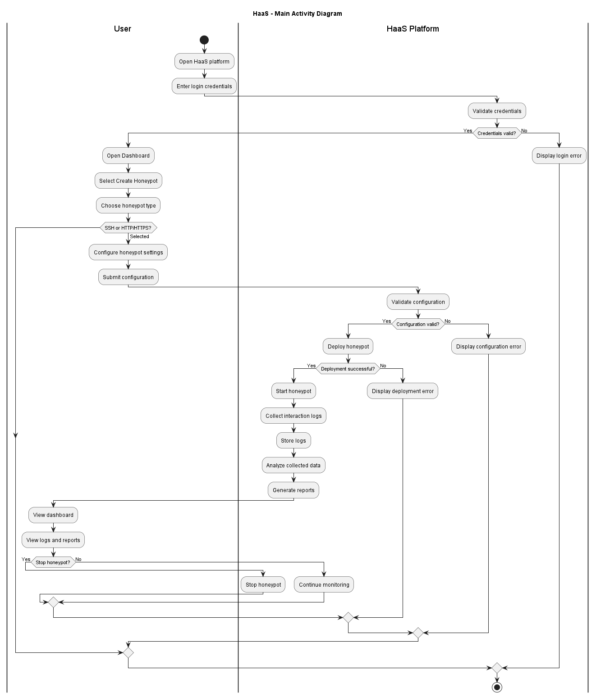

# HaaS – Main Activity Diagram

## Overview

This activity diagram illustrates the main workflow of the Honeypot-as-a-Service (HaaS) platform. It describes how users interact with the system, from authentication and honeypot creation to deployment, monitoring, log collection, and report visualization.

## Objectives

- Describe the overall workflow of the HaaS platform.
- Show the interaction between the user and the platform.
- Illustrate the honeypot creation and deployment process.
- Represent monitoring, log collection, and analysis activities.
- Show the main decision points in the system.

## Main Workflow

1. **Authentication:** The user logs into the HaaS platform.
2. **Honeypot Creation:** The user selects a honeypot type (SSH or HTTP/HTTPS).
3. **Configuration:** The user configures the honeypot settings.
4. **Validation:** The platform validates the submitted configuration.
5. **Deployment:** The platform deploys the honeypot.
6. **Monitoring:** The honeypot starts collecting interaction logs.
7. **Log Processing:** The platform stores and analyzes collected logs.
8. **Visualization:** The user views activity logs and reports through the dashboard.
9. **Management:** The user can stop the honeypot or continue monitoring.

## Diagram

## Diagram Source

The diagram was created using PlantUML.

- Source file: `activity-diagram.puml`
- Export format: PNG

## Scope

This diagram represents the overall workflow of the HaaS MVP, including SSH and HTTP/HTTPS honeypots. It provides a high-level view of the system activities rather than detailed implementation logic.

## Related Documentation

- [Context Diagram](../context-diagram/README.md)
- [Use Case Diagram](../use-case-diagram/README.md)
