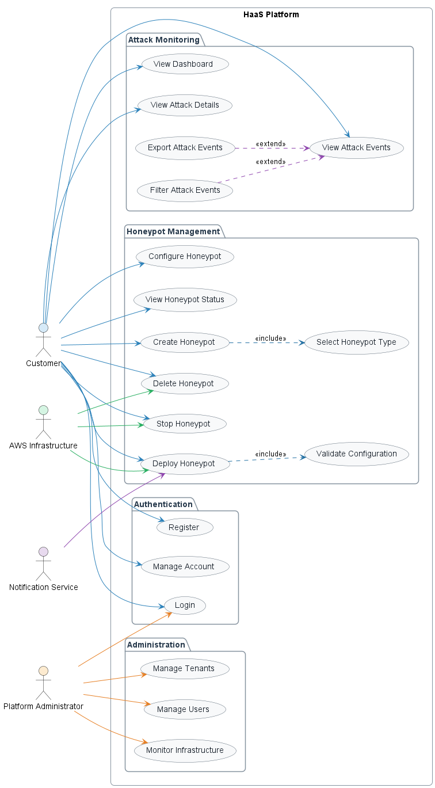

# HaaS Use Case Diagram

## Overview
This diagram describes the interactions between users and the Honeypot as a Service (HaaS) platform.

## Actors
- Customer
- Platform Administrator
- AWS Infrastructure
- Notification Service

## Main Functionalities
- Authentication and account management
- Honeypot management
- SSH honeypot deployment
- HTTP/HTTPS honeypot deployment
- Attack monitoring
- Platform administration

## Diagram

## Source
The UML diagram source is available in `use-case-diagram.puml`.

**Technology:** PlantUML
